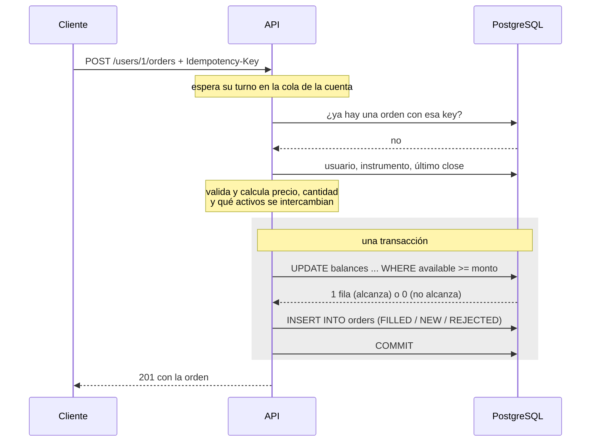

# Cocos Challenge API

API REST del challenge de backend de Cocos: portfolio de un usuario, búsqueda de activos y envío de órdenes de compra y venta (`MARKET` y `LIMIT`), con cancelación.

Está hecha con Node.js, TypeScript, Fastify y PostgreSQL. Además de cumplir el enunciado, está pensada para lo que pasa con tráfico real: muchas órdenes simultáneas sobre la misma cuenta, cancelaciones repetidas, reintentos del cliente y cuentas que intentan usar todas las conexiones a la base.

La documentación son tres piezas:

- **Este README**: qué pedía el enunciado, cómo levantarla, endpoints, cómo funciona y decisiones.
- **[docs/base-de-datos.md](docs/base-de-datos.md)**: cambios al esquema, cómo se resolvió cada lectura y cada escritura, y mejoras posibles en un ambiente productivo.
- **[postman_collection.json](postman_collection.json)**: 34 pedidos que comprueban solos su respuesta.

## Qué pedía el enunciado

| El enunciado pide | Dónde está |
|---|---|
| Portfolio: valor total de la cuenta, pesos disponibles y posiciones con cantidad, valor y rendimiento | `GET /users/:userId/portfolio` |
| Buscar activos por ticker o por nombre | `GET /instruments?q=` |
| Enviar órdenes de compra y venta, `MARKET` y `LIMIT`, por cantidad o por monto en pesos | `POST /users/:userId/orders` |
| La orden queda grabada en `orders`: `MARKET` → `FILLED`, `LIMIT` → `NEW`, sin saldo → `REJECTED` | El mismo endpoint |
| Solo se cancelan órdenes en `NEW` | `POST /users/:userId/orders/:orderId/cancel` |
| Tenencia y pesos calculados desde `orders`; retorno diario con `close` y `previousClose` | Portfolio |
| Test funcional del envío de una orden | `test/functional/place-order.test.ts` y otros 11 archivos |
| Colección de Postman (opcional) | [postman_collection.json](postman_collection.json) |
| Documentar supuestos y decisiones | [Decisiones y supuestos](#decisiones-y-supuestos) |
| Justificar los cambios a la base | [docs/base-de-datos.md](docs/base-de-datos.md) |

No hay autenticación ni simulación del mercado, como indica el enunciado.

## Cómo levantarla

Requisitos: Node.js 24 o superior (desarrollada con la 26) y Docker.

```bash
cp .env.example .env
docker compose up -d db     # Postgres 17 con el database.sql del challenge, en el puerto 5433
npm install
npm run migrate             # aplica los cambios de esquema
npm run dev                 # http://localhost:3000
```

La documentación interactiva queda en <http://localhost:3000/docs> (OpenAPI generado desde los mismos esquemas que validan cada ruta). Para correr todo en Docker, sin Node instalado: `docker compose --profile api up --build`.

| Comando | Qué hace |
|---|---|
| `npm test` | Tests unitarios y funcionales (necesita la base levantada) |
| `npm run typecheck` / `npm run lint` | Chequeo de tipos y lint |
| `npm run reconcile` | Verifica que los saldos coincidan con lo que dicen las órdenes |
| `npm run demo:concurrency` | Manda 20 compras simultáneas a la API levantada y muestra el resultado |

No hay paso de build: Node ejecuta TypeScript de forma nativa.

## Endpoints

| Método y ruta | Qué hace |
|---|---|
| `GET /users/:userId/portfolio` | Valor total de la cuenta, pesos disponibles y posiciones |
| `GET /instruments?q=texto&limit=20` | Busca activos por ticker o nombre |
| `POST /users/:userId/orders` | Envía una orden. Requiere el header `Idempotency-Key` |
| `POST /users/:userId/orders/:orderId/cancel` | Cancela una orden en estado `NEW` |
| `GET /health/live`, `GET /health/ready` | Estado del proceso y de su conexión a la base |

### Portfolio

```bash
curl http://localhost:3000/users/1/portfolio
```

Respuesta con los datos del challenge (se muestra una de las dos posiciones):

```json
{
  "userId": 1,
  "totalAccountValue": 904784,
  "availableCash": 627500,
  "reservedCash": 125500,
  "positions": [
    {
      "instrumentId": 47,
      "ticker": "PAMP",
      "name": "Pampa Holding S.A.",
      "quantity": 40,
      "reservedQuantity": 0,
      "averageCost": 930,
      "lastPrice": 925.85,
      "marketValue": 37034,
      "totalReturnPercent": -0.45,
      "dailyReturnPercent": 0.44
    }
  ]
}
```

| Campo | Cómo se calcula |
|---|---|
| `quantity` | Compras `FILLED` menos ventas `FILLED` |
| `averageCost`, `totalReturnPercent` | Costo promedio ponderado; el rendimiento es el valor de mercado contra ese costo. Vender no cambia el costo promedio de lo que queda |
| `dailyReturnPercent` | `close` contra `previousClose` |
| `availableCash` | `CASH_IN` y ventas, menos `CASH_OUT` y compras, menos lo reservado |
| `reservedCash`, `reservedQuantity` | Pesos y acciones apartados por órdenes `LIMIT` en `NEW` |
| `totalAccountValue` | Pesos disponibles y reservados, más el valor de mercado de las posiciones |

### Buscar activos

```bash
curl "http://localhost:3000/instruments?q=pamp"
```

Busca el texto dentro del ticker o del nombre, sin distinguir mayúsculas. Primero va el ticker exacto, después los tickers que empiezan con el texto y después el resto, en orden alfabético. `limit` admite de 1 a 100 y vale 20 por defecto.

Cada resultado trae `id`, `ticker`, `name`, `type`, el último precio (`lastPrice`, con su fecha en `priceDate`), `previousClose` y `dailyReturnPercent`.

### Enviar una orden

```bash
curl -X POST http://localhost:3000/users/1/orders \
  -H "Content-Type: application/json" \
  -H "Idempotency-Key: $(uuidgen)" \
  -d '{"instrumentId": 47, "side": "BUY", "type": "MARKET", "size": 10}'
```

| Campo | Detalle |
|---|---|
| `instrumentId` | Id del activo |
| `side` | `BUY` o `SELL` |
| `type` | `MARKET` o `LIMIT` |
| `size` | Cantidad exacta de acciones. Excluyente con `amount` |
| `amount` | Monto total en pesos; se opera la mayor cantidad entera de acciones que ese monto paga |
| `price` | Precio límite. Obligatorio en `LIMIT`, no permitido en `MARKET` |

Respuesta (`201`):

```json
{
  "id": 12,
  "userId": 1,
  "instrumentId": 47,
  "side": "BUY",
  "type": "MARKET",
  "status": "FILLED",
  "size": 10,
  "price": 925.85,
  "total": 9258.5,
  "rejectionReason": null,
  "datetime": "2026-11-18T19:27:55.204Z"
}
```

- `MARKET` se ejecuta al último `close` y queda `FILLED`.
- `LIMIT` queda `NEW` y reserva lo que compromete: pesos si es compra, acciones si es venta.
- Si el saldo no alcanza, la orden se graba igual, con estado `REJECTED` y `rejectionReason` (`INSUFFICIENT_FUNDS` o `INSUFFICIENT_SHARES`). La respuesta también es `201`.
- Repetir el pedido con la misma `Idempotency-Key` devuelve la orden original (`200` con el header `Idempotent-Replayed: true`) en vez de crear otra.

### Cancelar una orden

```bash
curl -X POST http://localhost:3000/users/1/orders/5/cancel
```

Solo se cancelan órdenes en `NEW`; la reserva vuelve al saldo disponible. Repetir la cancelación devuelve la misma orden ya cancelada (`200`). Cancelar una orden `FILLED` o `REJECTED` responde `409`.

### Errores

Todos tienen el mismo formato. `code` es estable y está pensado para que lo lea un programa; con `requestId` se encuentra el pedido en el log.

```json
{
  "error": {
    "code": "ORDER_NOT_CANCELLABLE",
    "message": "La orden 2 está en estado FILLED; solo se cancelan órdenes en estado NEW",
    "requestId": "6145f552-9c38-4f18-be05-9cde8ef699ba",
    "details": { "orderId": 2, "status": "FILLED" }
  }
}
```

| Status | Cuándo | Ejemplos de `code` |
|---|---|---|
| `400` | Pedido mal formado o incoherente | `VALIDATION_ERROR`, `PRICE_NOT_ALLOWED`, `SIZE_AND_AMOUNT_ARE_EXCLUSIVE` |
| `404` | El usuario, el instrumento o la orden no existen | `USER_NOT_FOUND`, `ORDER_NOT_FOUND` |
| `409` | La orden existe pero su estado no admite la operación | `ORDER_NOT_CANCELLABLE` |
| `415` | El cuerpo no es JSON | |
| `422` | El pedido es válido pero una regla lo impide | `INSTRUMENT_NOT_TRADABLE`, `MARKET_PRICE_UNAVAILABLE`, `AMOUNT_BELOW_UNIT_PRICE`, `IDEMPOTENCY_KEY_REUSED` |
| `429` | La cuenta ya tiene demasiados pedidos en curso | `TOO_MANY_REQUESTS` |
| `500` | Falla no prevista. El detalle queda en el log, no en la respuesta | `INTERNAL_ERROR` |
| `503` | La instancia o la base no pueden atender el pedido ahora | `SERVER_BUSY`, `ACCOUNT_BUSY`, `DATABASE_BUSY`, `DATABASE_UNAVAILABLE` |

`429` y `503` llevan `Retry-After`. Se reintenta con la misma `Idempotency-Key`: nunca se crean dos órdenes.

## Cómo funciona



1. **El saldo no se lee: se descuenta con una condición.** Un `UPDATE` resta el monto solo si alcanza. Si afecta una fila, la orden queda aceptada (`FILLED` o `NEW`); si no afecta ninguna, se graba `REJECTED`. Con 20 órdenes simultáneas, Postgres las hace pasar de a una por esa fila y nunca dos deciden sobre el mismo saldo.
2. **`balances` es una tabla nueva**, con una fila por cuenta y activo (los pesos son la fila del instrumento ARS). Se actualiza en la misma transacción que cada orden. `orders` sigue siendo la fuente de verdad, y el portfolio se calcula desde `orders`, como pide el enunciado.
3. **Una `LIMIT` en `NEW` reserva** lo que compromete. Cancelar es un `UPDATE ... WHERE status = 'NEW'`: si llegan diez cancelaciones juntas, una sola libera la reserva.
4. **`Idempotency-Key` es obligatoria.** El cliente genera una por intención de operar. Un reintento o un doble tap devuelve la orden original. Lo garantiza un índice único en Postgres, así que vale entre instancias y después de un reinicio.
5. **Cola por cuenta y tope de pedidos en curso.** Hasta 2 pedidos de una cuenta trabajan a la vez y 20 esperan en memoria; el siguiente recibe `429`. Una instancia atiende hasta 500 pedidos a la vez; el siguiente recibe `503`. Así una sola cuenta no deja sin conexiones a las demás.
6. **Ninguna espera es indefinida.** Esperar una conexión, un lock o una sentencia tiene límite. Vencido, la transacción se deshace y la API responde `503`.

El porqué de cada punto, con su SQL, sus mediciones y los tests que lo prueban, está en [docs/base-de-datos.md](docs/base-de-datos.md).

## Decisiones y supuestos

| Decisión | Por qué |
|---|---|
| Las `LIMIT` en `NEW` reservan saldo | El enunciado no lo define. Sin reserva, un usuario podría dejar diez órdenes límite por el mismo saldo |
| Sin saldo, la orden se graba `REJECTED` y responde `201`. Un pedido inválido responde un error y no graba nada | Lo primero es el caso que describe el enunciado. Una orden sin instrumento o sin cantidad no tiene valores con los que grabarse |
| `Idempotency-Key` obligatoria (`400` si falta) | En una API que mueve plata, un reintento no puede crear una segunda orden |
| Endpoint de cancelación | El enunciado define `CANCELLED` y la regla, pero no lista el endpoint. Sin él, las reservas de las `LIMIT` no se liberarían nunca |
| Sin endpoints para consultar órdenes ni para crear transferencias | El enunciado no los pide. `CASH_IN` y `CASH_OUT` se leen de `orders` para calcular saldos |
| Sin venta en corto | No se puede vender más de lo disponible |
| Dinero en centavos enteros (`BigInt`) | La aritmética es exacta. Un importe con más de 2 decimales se rechaza en vez de redondearse |
| Precio de una `MARKET`: el `close` más reciente | Lo indica el enunciado. Un instrumento sin precio solo admite `LIMIT` |
| Con `amount` en una `LIMIT`, la cantidad se calcula con el precio límite | Es el precio al que se ejecutaría |
| `userId` en la ruta | No hay autenticación. En producción lo resuelve el BFF desde la sesión |
| Validación estricta del cuerpo | Solo JSON, sin conversión de tipos (`"10"` no pasa como cantidad) y sin propiedades desconocidas |
| Búsqueda literal | `%` y `_` no actúan como comodines; no se aceptan caracteres de control |
| `orders.datetime` en UTC | La columna no tiene zona horaria |

Hallazgos en los datos provistos:

- **Posición sobrevendida.** El usuario 1 compró 20 acciones de BMA (orden 9) y vendió 30 (orden 11), las dos `FILLED`. Queda en −10, algo que esta API no habría permitido. El portfolio lista solo cantidades positivas, así que BMA no aparece.
- **Instrumentos sin precio.** PGR (3) e IRCP (10) no tienen filas en `marketdata`. Aparecen en la búsqueda con precio nulo y una orden `MARKET` sobre ellos responde `422`.
- **Precios con 8 decimales.** `database.sql` los trae así y la columna es `NUMERIC(10, 2)`: Postgres los redondea a 2 al insertarlos.

## Diseño del código

Fastify aporta el servidor, la validación por esquema y el logger. La estructura de la aplicación es propia:

- **Capas con dependencias hacia el dominio**: HTTP → casos de uso → puertos → dominio. Los repositorios implementan los puertos y son el único lugar que conoce las tablas. `test/unit/architecture.test.ts` falla si una dependencia apunta para el otro lado.
- **Puertos y unidad de trabajo**: los casos de uso reciben interfaces, no conexiones, y deciden qué se confirma junto sin saber que detrás hay una transacción. Por eso se prueban también sin base, contra versiones en memoria.
- **Estrategia por tipo de orden** y **patas por lado**: el caso de uso no tiene `if` por `MARKET`/`LIMIT` ni por compra/venta. Agregar un tipo de orden es agregar una estrategia.
- **Máquina de estados** como tabla de transiciones.
- **Control de admisión como decorador** de los casos de uso, aplicado en la raíz de composición (`src/app.ts`). Ni los casos de uso ni las rutas saben que existe.
- **Errores propios** con categoría de negocio. La traducción a HTTP está en un único archivo (`src/plugins/error-handler.ts`).
- **Log estructurado**: JSON, una línea por evento, con eventos de negocio (`order.placed`, `order.rejected`, `order.replayed`, `order.cancelled`) y de rechazo (`request.refused`, `request.unavailable`, `request.failed`). Todas las líneas de un pedido comparten el `reqId`, que vuelve en el header `x-request-id` y en el cuerpo de los errores.
- **Funciones cortas**: ninguna supera las 30 líneas.

```
db/init/database.sql     carga inicial: el archivo del challenge, sin cambios
db/migrations/           cambios de esquema versionados
src/
  server.ts              arranque y apagado ordenado
  app.ts                 raíz de composición: conecta repositorios, casos de uso y control de admisión
  shared/                dinero, errores, unidad de trabajo, control de admisión, base, migrador
  plugins/               manejo de errores, validación, health, OpenAPI
  modules/
    orders/              domain/ (reglas puras), ports.ts, place-order.ts, cancel-order.ts,
                         *.repository.ts (SQL), esquemas, mappers y rutas HTTP
    portfolio/           misma organización
    instruments/         misma organización
    market/, users/      puertos y repositorios de lectura
scripts/                 migrate, reconcile, demo de concurrencia
test/                    unit/, functional/ (la API completa contra Postgres) y helpers/
```

## Tests

```bash
npm test
```

463 tests con el runner nativo de Node, en unos 5 segundos. Los funcionales levantan la aplicación completa contra Postgres real: cada archivo crea un schema descartable, carga `database.sql`, aplica las migraciones y lo borra al terminar.

Los casos se eligen de tres formas: ejemplos con valores exactos, una matriz generada con las 32 combinaciones de tipo × lado × cantidad o monto × situación del saldo, y propiedades con [fast-check](https://fast-check.dev), que genera secuencias de operaciones al azar y las compara contra un modelo de referencia.

| Qué se prueba | Archivos (`test/functional/` y `test/unit/`) |
|---|---|
| Envío de órdenes: tipos, lados, cantidad y monto, rechazos por saldo, pedidos inválidos y valores límite | `place-order`, `order-matrix`, `order-edge-cases` |
| Órdenes simultáneas: doble gasto, doble venta, compras y ventas cruzadas, cancelaciones a la vez | `concurrency`, `cancel-order` |
| Reintentos y doble tap, entre instancias y después de un reinicio | `idempotency` |
| Cola por cuenta, tope global, locks retenidos y pool agotado | `admission` (funcional y unitario), `resilience` |
| Secuencias al azar de compras, ventas, cancelaciones y reintentos | `order-properties`, `properties` |
| Portfolio y búsqueda | `portfolio`, `instruments`, `portfolio-calculator`, `read-use-cases`, `search-and-config` |
| Dominio y casos de uso sin base, capas, y qué queda en el log | `order-domain`, `order-use-cases`, `money`, `architecture`, `logging` |

Cada test de concurrencia y cada propiedad termina comprobando que `balances` coincide con el recálculo desde `orders`.

## Probarla con Postman

1. Levantar la API sobre la base recién creada, como se indica en [Cómo levantarla](#cómo-levantarla).
2. Importar [postman_collection.json](postman_collection.json) en Postman y elegir "Run collection".

Cada pedido comprueba su respuesta: son 34 pedidos y 121 verificaciones, que tienen que pasar todas.

| Carpeta | Qué comprueba |
|---|---|
| Portfolio | Los campos que pide el enunciado; valor total = pesos + posiciones; usuario inexistente → `404` |
| Instrumentos | Búsqueda por ticker y por nombre, `limit`, búsqueda vacía → `400` |
| Órdenes | `MARKET` → `FILLED`, `LIMIT` → `NEW`, sin saldo → `REJECTED` con su motivo; cantidad calculada desde el monto; la reserva de una `LIMIT` aparece en el portfolio y vuelve al cancelarla; cancelar dos veces la devuelve una sola vez |
| Idempotencia | `201`, después `200` con la misma orden y `Idempotent-Replayed: true`, después `422` |
| Errores | Status y `code` de nueve pedidos inválidos |
| Operación | Health y especificación OpenAPI |

Dentro de Órdenes y de Idempotencia los pedidos van en orden, porque cada uno usa lo que guardó el anterior. La colección se puede correr varias veces seguidas. Para volver a los datos iniciales: `docker compose down -v`, y otra vez `docker compose up -d db` y `npm run migrate`.

Lo que Postman no puede mostrar son los pedidos simultáneos. Para eso están `npm run demo:concurrency`, que manda 20 compras a la vez contra la API levantada, y los tests de concurrencia.

## En producción

Esta API es el servicio de negocio: es dueña de las reglas y de los datos, y está pensada para vivir en una red privada. Delante va un BFF expuesto a internet, que autentica al usuario, resuelve el `userId` desde la sesión, limita cuántos pedidos por segundo manda cada usuario y adapta las respuestas para la app. El BFF no resuelve consistencia ni concurrencia: eso vive acá y en Postgres, y vale sin importar quién llame. La API se protege igual, con la cola por cuenta, el tope y los timeouts, porque no puede depender de que todo el que la llama se porte bien.

Lo que haría falta para crecer (réplicas de lectura, PgBouncer, ejecuciones parciales, outbox, entre otras) está en [Mejoras posibles](docs/base-de-datos.md#5-mejoras-posibles-en-un-ambiente-productivo).
